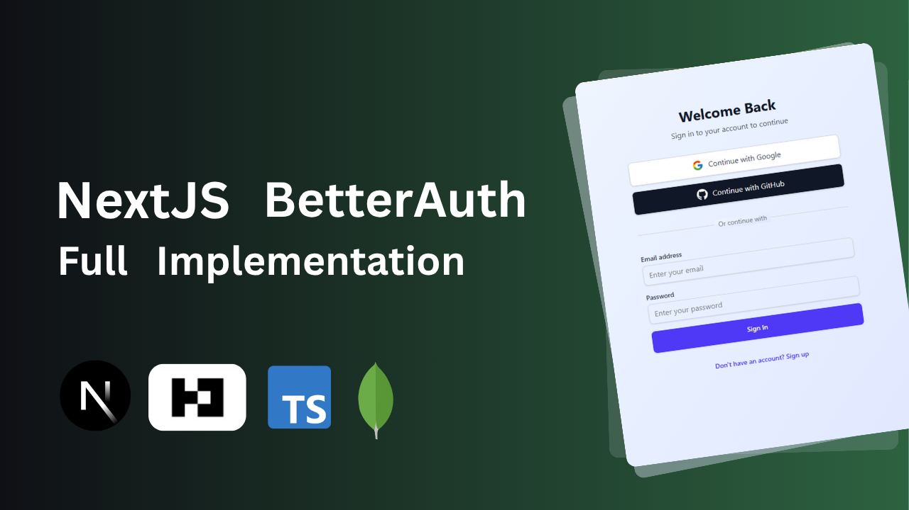

# Next.js Authentication with Better Auth

<div align="center">
  <br />
  <a href="#features">
    
  </a>
  <br /><br />
  
  
  
  
  <br /><br />
  <p><b>Learn how authentication works and why each step matters.</b></p>
</div>

## 📋 Table of Contents

1. [Introduction](#-introduction)
2. [Tech Stack](#️-tech-stack)
3. [Features](#-features)
4. [Project Structure](#-project-structure)
5. [Prerequisites](#-prerequisites)
6. [Getting Started](#-getting-started)
7. [Environment Variables](#-environment-variables)
8. [MongoDB Setup](#-mongodb-setup)
9. [OAuth Configuration](#-oauth-configuration)
10. [Deployment](#-deployment)
11. [Useful Links](#-useful-links)
12. [License](#-license)

---

## 🚀 Introduction

This repository helps developers learn authentication in **Next.js using Better Auth and MongoDB**.

It is organized into two projects:

- **Starter Code:** A Next.js project with a ready-made UI, allowing you to focus on authentication without worrying about UI development.
- **Final Code:** A Next.js project containing the completed implementation for understanding the authentication workflow.

The goal is to understand how authentication works, why each step matters, and how to implement authentication features in a Next.js application.

## ⚙️ Tech Stack

-  React framework with the App Router

-  Open-source authentication and session management

-  NoSQL database for authentication data

-  Type-safe development
-  Code formatting and linting

-  **and**   UI development

-  Icons for the interface

## ⚡ Features

- 🔐 **Email/Password Authentication** — User sign-up and sign-in
- 🌐 **Google OAuth** — Social authentication with Google
- 🐙 **GitHub OAuth** — Social authentication with GitHub
- 🔒 **Session Management** — Manage authenticated user sessions
- 🛡️ **Protected Routes** — Restrict access to authenticated pages
- 📝 **Input Validation** — Validate authentication form inputs
- 🎨 **Ready-Made UI** — Focus on authentication instead of building the interface
- 📚 **Learning-Oriented Structure** — Separate starter and completed projects

> OAuth providers and other features require the corresponding implementation and configuration in the project you run.

## 📁 Project Structure

```text
.
├── starter-code/
│   ├── src/
│   ├── public/
│   ├── package.json
│   ├── biome.json
│   └── README.md
├── final-code/
│   ├── src/
│   ├── public/
│   └── package.json
├── banner.png
├── README.md
└── LICENSE
```

The exact contents of each project may differ as the implementation evolves.

### Starter Code

Use this project to begin implementing authentication with the UI already prepared.

### Final Code

Use this project to study the completed implementation and compare it with your own work.

## 📦 Prerequisites

- [Node.js](https://nodejs.org/)
- npm
- A [MongoDB Atlas](https://www.mongodb.com/products/platform/atlas-database) cluster or a local MongoDB instance
- Google OAuth credentials, if using Google sign-in
- GitHub OAuth credentials, if using GitHub sign-in

## 🚀 Getting Started

### 1. Clone the Repository

```bash
git clone https://github.com/moinul-islam-dev/better-auth-nextjs.git
cd better-auth-nextjs
```

Replace the placeholders with your GitHub username and repository name.

### 2. Choose a Project

To start with the ready-made UI:

```bash
cd starter-code
npm install
```

To run the completed implementation instead, navigate to `final-code` from the repository root and install its dependencies:

```bash
cd final-code
npm install
```

Install dependencies separately for the project you want to run.

### 3. Configure Environment Variables

Create a `.env` file in the selected project's root directory. Use the exact variable names expected by that project's configuration.

Example:

```env
BETTER_AUTH_URL="http://localhost:3000"
BETTER_AUTH_SECRET="your-secure-secret"
BETTER_AUTH_MONGODB_URI="your-mongodb-connection-string"

GOOGLE_CLIENT_ID="your-google-client-id"
GOOGLE_CLIENT_SECRET="your-google-client-secret"

GITHUB_CLIENT_ID="your-github-client-id"
GITHUB_CLIENT_SECRET="your-github-client-secret"
```

Replace the example values with your actual configuration. OAuth variables are required only when the corresponding provider is configured.

**Security:** Never commit real secrets, database credentials, or OAuth client secrets to Git.

### 4. Start the Development Server

```bash
npm run dev
```

Open [http://localhost:3000](http://localhost:3000) in your browser.

Check the selected project's `package.json` for the available scripts.

## 🍃 MongoDB Setup

This project uses MongoDB rather than PostgreSQL.

1. Create a MongoDB database using **MongoDB Atlas (recommended)** or a local MongoDB installation.
2. Obtain the connection string for your database.
3. Add the connection string to the environment variable expected by your Better Auth configuration.
4. Verify that the database user has the necessary permissions and that your network configuration allows the connection.
5. Start the application and test the authentication flow.

Better Auth's MongoDB integration manages the authentication data according to its configured adapter and schema requirements. Follow the database setup instructions for the specific Better Auth version used in your project.

## 🔑 OAuth Configuration

### Google OAuth

1. Open the [Google Cloud Console](https://console.cloud.google.com/).
2. Create or select a project.
3. Configure the OAuth consent screen.
4. Create OAuth client credentials.
5. Configure the authorized redirect URI required by your Better Auth setup.
6. Add the client ID and client secret to your environment variables.

### GitHub OAuth

1. Open [GitHub Developer Settings](https://github.com/settings/developers).
2. Create an OAuth App.
3. Configure the application homepage URL.
4. Set the authorization callback URL required by your Better Auth configuration.
5. Add the client ID and client secret to your environment variables.

Use the actual callback URLs generated by your authentication configuration rather than assuming a fixed path.

## ☁️ Deployment

You can deploy the application to a compatible hosting provider, such as [Vercel](https://vercel.com/).

Before deploying:

1. Push your code to GitHub.
2. Configure the production MongoDB connection string.
3. Set the production authentication URL and a secure Better Auth secret.
4. Configure OAuth credentials and production callback URLs.
5. Add the required environment variables to your hosting provider.
6. Deploy the application and test sign-up, sign-in, sessions, and OAuth flows.

Never expose database credentials or authentication secrets in client-side code.

## 🔗 Useful Links

- [Better Auth Documentation](https://www.better-auth.com/)
- [Next.js Documentation](https://nextjs.org/docs)
- [MongoDB Documentation](https://www.mongodb.com/docs/)
- [MongoDB Atlas](https://www.mongodb.com/products/platform/atlas-database)
- [TypeScript Documentation](https://www.typescriptlang.org/docs/)
- [Biome Documentation](https://biomejs.dev/)
- [Google OAuth Documentation](https://developers.google.com/identity/protocols/oauth2)
- [GitHub OAuth Documentation](https://docs.github.com/en/apps/oauth-apps/building-oauth-apps)
- [Vercel Documentation](https://vercel.com/docs)

## 📄 License

This project is licensed under the [MIT License](./LICENSE).
